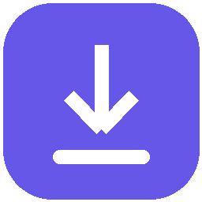
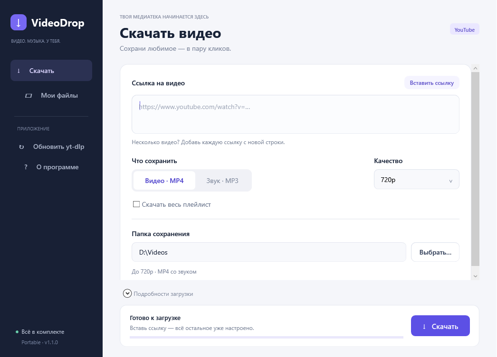

<p align="center">
  
</p>
<h1 align="center">VideoDrop</h1>
<p align="center">Видео и музыка с YouTube — в пару кликов.</p>
<p align="center">
  <a href="https://github.com/dm-tupikov/VideoDrop/releases/latest"></a>
  
  
  <a href="LICENSE"></a>
</p>

VideoDrop — портативное приложение для Windows с удобным русским интерфейсом поверх [yt-dlp](https://github.com/yt-dlp/yt-dlp). Вставь ссылку, выбери формат и папку, нажми «Скачать». Устанавливать Python, FFmpeg или другие инструменты отдельно не нужно.



## Скачать и запустить

**[Скачать последнюю версию →](https://github.com/dm-tupikov/VideoDrop/releases/latest)**

1. В разделе Assets скачай `VideoDrop-Portable.exe`.
2. Положи EXE в обычную папку с правом записи и запусти.
3. Вставь ссылку YouTube, проверь папку и нажми **Скачать**.

При первом запуске встроенные инструменты распакуются в `VideoDrop-data` рядом с EXE. Для распаковки интернет не нужен. По умолчанию ролики сохраняются в соседнюю папку `Downloads`, качество — **до 720p**, формат — **MP4 со звуком**.

## Возможности

- Видео в MP4: 480p, 720p, 1080p, 1440p, 2160p или лучшее доступное качество.
- Сохранение только звука в MP3.
- Несколько ссылок: по одной на строку.
- Плейлисты по отдельному флажку; обычная ссылка сохраняет только выбранное видео.
- Прогресс, скорость, оставшееся время и отмена с продолжением частичных загрузок.
- Выбор папки, сохранение настроек и кнопка **Мои файлы**.
- Обновление yt-dlp из официального проекта одной кнопкой.
- Подробный журнал под раскрывающейся панелью; при ошибке он открывается автоматически.
- Интерфейс на WPF с поддержкой масштаба Windows, изменения размера и клавиатуры.

Выбранное разрешение — **верхний предел**. Если оно недоступно, приложение выберет меньшее. Оно не увеличивает разрешение исходного ролика. MP3 создаётся из лучшей доступной аудиодорожки; преобразование не улучшает качество оригинала.

## Системные требования

Windows 10/11 x64 со встроенным .NET Framework 4.x (WPF), доступ к YouTube и папка с правом записи. Отдельные Python, .NET SDK, FFmpeg и Deno для запуска не требуются. Встроенные инструменты занимают около 320 МБ после распаковки; оставь место и для скачиваемых файлов.

Права администратора, установщик и изменение `PATH` не нужны. Для переноса достаточно EXE; чтобы сохранить настройки и обновлённый yt-dlp, перенеси также `VideoDrop-data`.

## Если загрузка не работает

1. Проверь, открывается ли ролик в браузере и доступен ли YouTube в твоей сети.
2. Нажми **Обновить yt-dlp** и повтори скачивание.
3. Раскрой **Подробности загрузки** и проверь сообщение об ошибке.

Ролики с ограничениями входа, возраста, региона или проверками против ботов могут быть недоступны. Приложение не импортирует cookies и учётные данные браузера. Не прикладывай к публичным issue приватные ссылки, токены или личные пути из журнала.

EXE не имеет цифровой подписи коммерческого издателя. Контрольная сумма выпуска находится в `SHA256SUMS.txt` в Assets. Проверить её можно командой PowerShell:

```powershell
Get-FileHash .\VideoDrop-Portable.exe -Algorithm SHA256
```

## Сборка из исходников

Для сборки нужны Windows x64, Python 3.9+ и встроенный компилятор C# из .NET Framework 4.x. Сторонние Python-пакеты и .NET SDK не нужны.

```powershell
git clone https://github.com/dm-tupikov/VideoDrop.git
cd VideoDrop
python scripts/fetch_deps.py
python scripts/test.py
python scripts/build.py
```

Готовый EXE и его SHA-256 появятся в `dist/`. Скрипт загрузки получает фиксированные официальные версии инструментов и сверяет SHA-256 по [`scripts/deps.lock.json`](scripts/deps.lock.json). Бинарные зависимости хранятся в `build/`, в Git они не добавляются. Встроенный ZIP собирается из этих бинарников и лицензионных уведомлений.

В [GitHub Actions](.github/workflows/build.yml) настроены сборка, проверки аргументов и подготовка артефакта для скачивания. Автоматическая публикация релиза не включена.

### Структура проекта

| Путь | Содержимое |
| --- | --- |
| `src/MainWindow.xaml` | Интерфейс WPF и стили |
| `src/App.cs` | События интерфейса и управление процессом загрузки |
| `src/Tools.cs` | Распаковка инструментов и аргументы yt-dlp |
| `scripts/` | Загрузка зависимостей, проверки и сборка |
| `licenses/` | Лицензии и уведомления сторонних компонентов |

## Лицензии

Исходный код оболочки VideoDrop распространяется по [MIT](LICENSE). Встроенные сторонние инструменты имеют собственные лицензии, включая GPLv3 у сборки FFmpeg. Они запускаются отдельными процессами. Версии, лицензии и ссылки на исходники указаны в [THIRD_PARTY.md](THIRD_PARTY.md) и включены в распакованные компоненты.

Сохраняй материалы, на скачивание которых у тебя есть разрешение. VideoDrop не связан с YouTube или Google.
